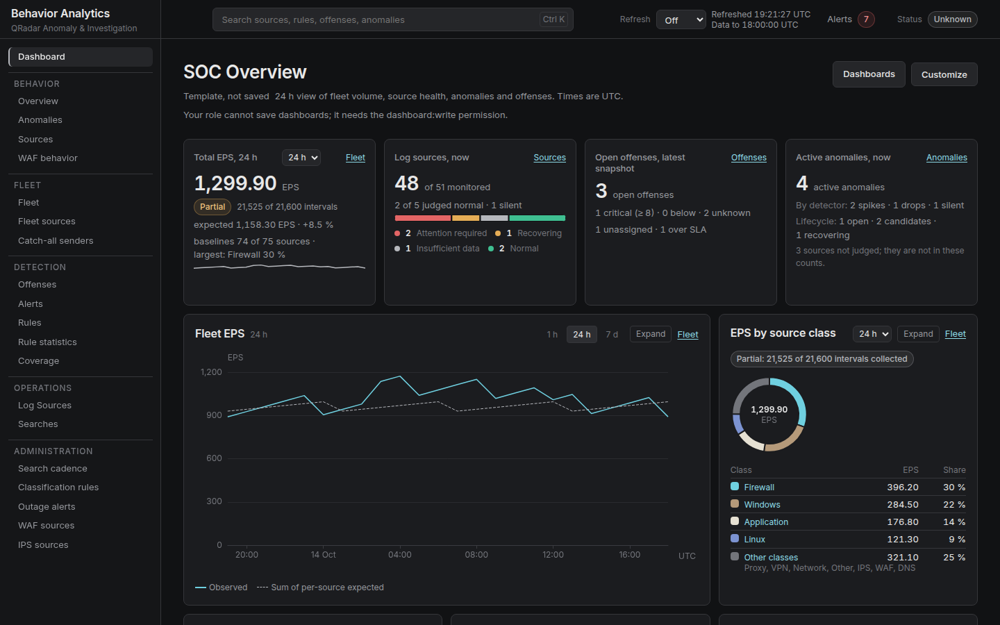

# Behavior Analytics

Behavior Analytics is an on-premises behavioural analytics platform for IBM QRadar that operates
strictly **read-only** against QRadar.



It learns normal behavior from aggregate telemetry, detects meaningful changes, and gives a SOC
analyst bounded evidence for the affected interval. It also brings QRadar inventory, offenses,
analytics-rule health, scheduled searches, alert lifecycle and ATT&CK coverage into one
investigation interface.

## What it detects

### Source volume

Behavior Analytics builds robust seasonal baselines for each log source and detects:

- volume spikes;
- volume drops; and
- sources that stop sending events.

Baselines use median and median absolute deviation for each weekday-and-hour cell. Event volume is
calculated with QRadar's event count, not Ariel row count, so coalesced records do not understate
traffic.

### WAF behavior

For enabled and validated WAF sources, the platform learns endpoint behavior and detects:

- request-rate spikes;
- blocked-request ratio increases;
- server- and client-error ratio increases;
- concentration behind a small set of clients; and
- newly accessed endpoints.

Every source has a versioned field mapping. Endpoint admission, result sizes and contributor lists
are bounded, and WAF collection and alerting are separate opt-ins.

### IPS behavior

For enabled and validated IPS sources, the platform monitors destination ports, destinations,
signatures, source concentration, port fan-out and action ratios. It detects rate spikes, signature
bursts, new destination ports, concentration changes, fan-out changes and block-ratio shifts.

Entities are admitted under explicit limits. Collection, evaluation and baseline training are
ordered per source, and alerting can remain in shadow mode while the SOC validates incidents.

### Log-source fleet

The fleet view classifies sources from synchronized QRadar inventory, highlights new or conflicting
sources, compares observed and expected volume by source class, and applies source- or class-level
outage policy. Catch-all monitoring shows which bounded sender names sit behind generic sources.

### Custom threshold detections

Operators can define threshold rules over aggregates the platform already stores. Rules support
sustain and recovery periods, previews and shadow-mode alerting. Evaluation is database-only and
does not add QRadar searches.

Stored custom AQL follows a separate guarded path: a search is validated, versioned and disabled on
creation before an operator can schedule it. Frontend-supplied AQL is never executed directly.

### Property watches

A property watch tracks one or two QRadar property values over a source, source type or source
group. It can detect value spikes, drops, disappearance, newly admitted values and new combinations.
Coverage, scope changes, admission and learning progress remain visible to the analyst.

## Honest about missing data

Every reading says whether it is **measured**, a **lower bound**, or **not collected**. A missing,
failed or truncated input never becomes a zero and never produces a healthy verdict. The UI keeps
`INSUFFICIENT_DATA`, `PARTIAL`, `TRUNCATED` and `NOT_COLLECTED` visible; a measured zero remains a
real zero.

## Architecture

- A Next.js and TypeScript frontend provides the analyst and administration interface.
- A FastAPI backend exposes the versioned API, authorization, audit and domain services.
- Celery workers and Beat run bounded collection, evaluation, training and retention jobs.
- PostgreSQL with TimescaleDB stores inventory, aggregates, baselines and lifecycle state.
- The direct `QRadarRestProvider` owns deterministic REST collection and the Ariel lifecycle.
- The optional MCP provider is limited to read-only inventory and cannot execute AQL.

The browser holds no QRadar credential. Raw QRadar events are not persisted; the platform stores
aggregates and the explicitly bounded contributor evidence needed for investigation.

See [Behavioral Analytics Architecture](docs/BEHAVIORAL-ANALYTICS-ARCHITECTURE.md) for the engine,
baseline, lifecycle and evidence design, and [Data model](docs/DATA-MODEL.md) for stored entities and
measurement semantics.

### From collection to investigation

1. Inventory sync discovers QRadar instances, log sources, types, groups, offenses and rules.
2. Each enabled search family claims its configured cadence slot—five minutes by default—and
   requests complete time buckets through the direct REST/Ariel provider.
3. Collectors validate fields, split truncated multi-bucket searches and fold raw rows into bounded
   aggregates. A failed or exhausted search leaves an explicit gap.
4. Detectors evaluate only the inputs their capability declarations permit. Seasonal baselines are
   trained only from compatible, sufficiently complete observations.
5. Hysteresis opens, recovers and resolves incidents without duplicating alerts on every bucket.
6. The investigation API joins the observation, expected band, lifecycle and bounded evidence for
   the analyst UI.

Every family isolates failures so one source or profile does not blind the rest of the fleet.
Bulk loaders keep per-run database work constant in the number of endpoints or watched values.

### Alerts and notifications

Alerts move from `OPEN` to `ACKNOWLEDGED` to `RESOLVED`. A database constraint prevents two active
alerts with the same fingerprint. Behavioral incidents, search thresholds, repeated search failure,
custom-rule breaches, new inventory and stale offense collection all use this lifecycle without
sharing fingerprints accidentally.

Operator actions and detector transitions enqueue notification intent in the database. Delivery is
asynchronous, retried and dead-lettered, so a slow Teams, email, Slack, webhook or syslog destination
does not delay the API action. Maintenance and record-only outage policy suppress paging without
inventing a healthy observation.

## Quick start

### Development with the mock provider

The deterministic mock provider needs no QRadar console:

```bash
git clone --recurse-submodules https://github.com/wiemBe/Behavior-Analytics.git
cd Behavior-Analytics
cp .env.example .env

python -c "import secrets; print('SECRET_KEY='+secrets.token_urlsafe(64))"
python -c "from cryptography.fernet import Fernet; print('ENCRYPTION_KEY='+Fernet.generate_key().decode())"
```

Put both generated values in `.env` and leave `QRADAR_PROVIDER=mock`, then run:

```bash
docker compose up -d postgres redis
docker compose run --rm migrate
docker compose run --rm backend python -m app.services.seed
docker compose up -d backend frontend celery-worker celery-beat
```

Open <http://localhost:3000>. See [Installation](docs/INSTALL.md) for the full local stack and
[Development](docs/DEVELOPMENT.md) for native backend, frontend and test commands.

### Production

On a Linux x86-64 host with Docker Engine, Compose v2, TLS material and a QRadar read-only service
token:

```bash
git clone --recurse-submodules https://github.com/wiemBe/Behavior-Analytics.git
cd Behavior-Analytics
./qradar-dash install
```

The installer checks the host, generates application secrets, loads QRadar and TLS files into
Docker volumes, migrates the database, creates the break-glass administrator and starts the stack
behind its TLS proxy. Release images are under `ghcr.io/wiembe/behavior-analytics/`.

Run `./qradar-dash status`, `./qradar-dash logs` and `./qradar-dash doctor` after installation.
The complete operator runbook is [Operations](docs/OPERATIONS.md), which is written in Turkish.

## Configuration and operations

Configuration comes from environment variables. The schema and defaults live in
`backend/app/core/config.py`; `.env.example` is the deployment template. Every QRadar search family
defaults to a **five-minute cadence**. Cadence controls when a family searches, while the collection
interval controls bucket width.

Start here:

- [Configuration reference](docs/CONFIGURATION.md) — settings, defaults and opt-in switches.
- [Search cadence](docs/SEARCH-CADENCE.md) — keyed searches, buckets, splitting and latency.
- [Installation](docs/INSTALL.md) — mock setup, production install, TLS and upgrades.
- [Operations](docs/OPERATIONS.md) — the Turkish runbook for backup, restore and diagnosis.
- [Operations design](docs/OPERATIONS-DESIGN.md) — installer, release and recovery internals.

WAF, IPS, property-watch, custom-rule and alerting switches default conservatively. Review their
collection cost and mapping prerequisites before enabling them on a production console.

### Proxy headers and the rate limiter

Production uses one HTTPS origin for the UI and `/api/`. If you choose `--external-proxy`, forward
those paths to the loopback ports printed by the installer and set `FORWARDED_ALLOW_IPS` to the
exact peer address Uvicorn sees. Do not use `*`: a client that can reach the backend could forge its
forwarded address and select a different rate-limit key.

Confirm the effective address after installation. If every analyst appears as the same Docker
bridge address, all of them share one `RATE_LIMIT_DEFAULT` bucket. The installer and
[Installation](docs/INSTALL.md) describe the supported topology. The manual QRadar registration
example there uses API version `29.0`; the application default remains `20.0`.

## Security model

- **Read-only QRadar boundary.** The provider interface has no create, update or delete methods.
- **AQL isolation.** Only the direct REST/Ariel provider executes stored, validated queries; MCP
  cannot execute AQL.
- **No raw-event persistence.** Collectors persist aggregates and bounded evidence only.
- **Mandatory TLS.** The REST provider requires HTTPS and refuses disabled certificate validation.
- **Secret isolation.** Tokens and keys stay out of source, logs, API responses and the browser;
  sensitive database values are encrypted at rest.
- **Defense in depth for MCP.** Write tools are disabled, the application has its own allowlist,
  and the service has no published port.
- **Authorization and audit.** Product routers are permission-guarded and administrative or analyst
  actions append audit records.
- **Fail-closed detection.** Missing capability, coverage or collection yields an explicit unknown
  state rather than a healthy result.
- **Bounded work.** Search concurrency, time range, rows, admissions, retention and per-run database
  work have explicit limits.
- **No autonomous actions.** The disabled-by-default LLM interface can analyze a redacted package
  but cannot act on QRadar or the local alert lifecycle.

The upstream MCP tool audit is published in the
[MCP capability matrix](docs/mcp-capability-matrix.md).

## Documentation

| Document | Contents |
|---|---|
| [Architecture](docs/BEHAVIORAL-ANALYTICS-ARCHITECTURE.md) | Behavioral engine, robust baselines, evidence and lifecycle |
| [API and interface](docs/API.md) | Route groups, permissions, frontend routes and shared API semantics |
| [Configuration](docs/CONFIGURATION.md) | Environment settings, code defaults and collection switches |
| [Data model](docs/DATA-MODEL.md) | Stored aggregates, hypertables and measurement semantics |
| [Development](docs/DEVELOPMENT.md) | Repository layout, local services, tests and dependency locks |
| [Field mapping](docs/FIELD-MAPPING.md) | WAF and IPS custom-property mapping model |
| [Installation](docs/INSTALL.md) | Development and production setup, TLS, proxy and upgrades |
| [Lab demo results](docs/LAB-DEMO-RESULTS.md) | Sanitized behavioral lab observations |
| [Synthetic telemetry lab](docs/LAB-SYNTHETIC-TELEMETRY.md) | Manual, opt-in lab generator and safety boundaries |
| [Operations](docs/OPERATIONS.md) | Turkish operator runbook |
| [Operations design](docs/OPERATIONS-DESIGN.md) | Release, install, backup, restore and diagnostic design |
| [Source-volume behavior](docs/PHASE-A-SOURCE-VOLUME-ANOMALY.md) | Source metrics, seasonal detection and investigation evidence |
| [WAF behavior](docs/PHASE-B-WAF-BEHAVIOR.md) | Endpoint model, collection, completeness and detectors |
| [Log-source fleet](docs/PHASE-C-LOG-SOURCE-FLEET.md) | Classification, outage policy and catch-all senders |
| [IPS behavior](docs/PHASE-D-IPS-BEHAVIOR.md) | Profiles, entities, fleet collection and detectors |
| [Rule analytics](docs/PHASE-E-RULE-ANALYTICS.md) | Measured rule matches, statistics and health limitations |
| [Custom detections](docs/PHASE-F-CUSTOM-DETECTIONS.md) | Aggregate threshold rules and guarded custom searches |
| [History bootstrap](docs/PHASE-G-HISTORY-BOOTSTRAP.md) | Bounded bootstrap design for property-watch history |
| [Property watches](docs/PHASE-G-PROPERTY-WATCH.md) | Scope, values, coverage, detection and alerting |
| [Product UX guidelines](docs/PRODUCT-UX-GUIDELINES.md) | Normative analyst-interface and accessibility rules |
| [Search cadence](docs/SEARCH-CADENCE.md) | Search families, scheduling, split behavior and cost |
| [MCP capability matrix](docs/mcp-capability-matrix.md) | Audited upstream tools, verbs, permissions and suitability |
| [Release 0.1.0](docs/releases/0.1.0.md) | Release notes and upgrade boundary for 0.1.0 |
| [Release 0.1.1](docs/releases/0.1.1.md) | Release notes and upgrade boundary for 0.1.1 |

## Operational limits worth knowing

- WAF, IPS and property-watch collection are off until explicitly enabled and configured.
- Custom threshold evaluation and its alerting switch are both off by default.
- General Timescale chunk retention is off unless an operator supplies explicit policies.
- QRadar rule inventory does not prove that a rule with no observed contribution has never fired;
  it remains insufficient data.
- Geography stores country aggregates only. Private, internal and unknown addresses share the same
  unresolved remainder because QRadar does not distinguish them in this lookup.
- Property-watch resolved-incident retention is configured but not yet applied by a worker task.
- The synthetic telemetry generator is never started by the backend, workers, Compose or tests.

## License

This repository is under the [Apache License, Version 2.0](LICENSE); see also [NOTICE](NOTICE)
(the vendored `qradar-mcp/` keeps its upstream Apache-2.0 `LICENSE` and `NOTICE`). IBM and QRadar
are trademarks of International Business Machines Corporation, registered in many jurisdictions
worldwide. This project is not affiliated with, sponsored by or endorsed by IBM.
